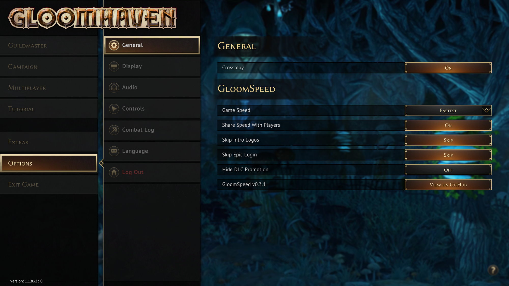
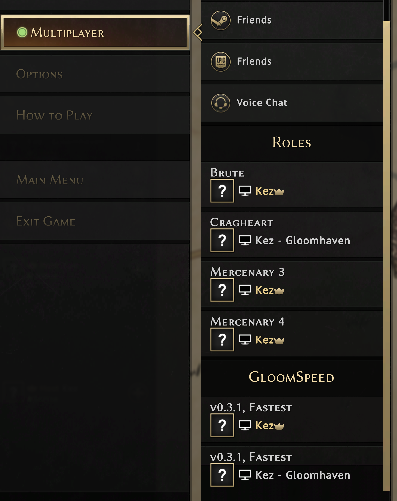
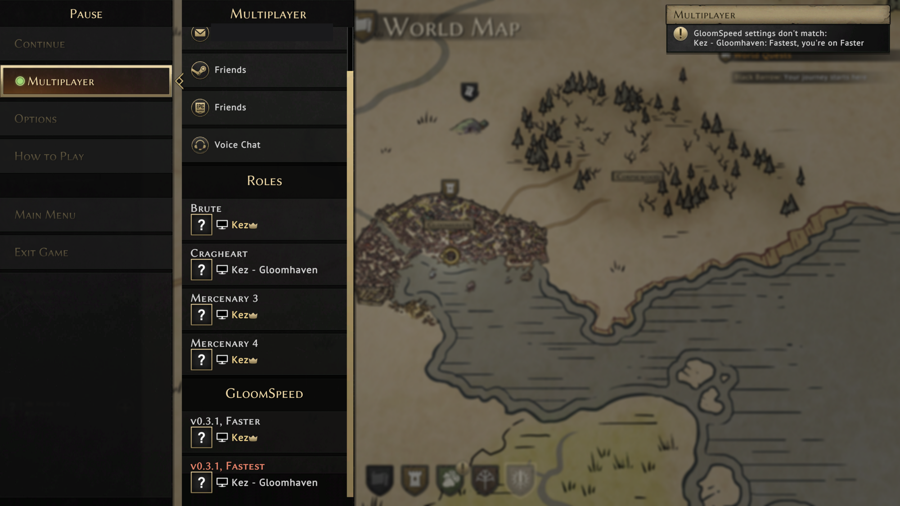

# Install GloomSpeed

GloomSpeed makes Gloomhaven's animations and enemy turns faster. It doesn't change the rules or your saves, and you can remove it at any time.

You don't need any experience with mods. The installer does the work, and these steps tell you what you'll see along the way. It takes about five minutes.

**Everyone in your group should install it, and use the same version.** The host waits for the slowest player, so one player without it can hold up the group.

- [Install on Windows](#windows)
- [Install on a Mac](#mac)
- [Install on Linux](#linux)
- [Check it worked](#check-it-worked)
- [Choosing your speed](#choosing-your-speed)
- [If something goes wrong](#if-something-goes-wrong)
- [Install by hand, without the installer](#install-by-hand)

> **This is an early test version.** Windows hasn't been tried on a real PC yet, including this installer. The Linux installer has only been run on a test folder, and hasn't been tried on Steam Deck. If something goes wrong, [removing the mod](#if-something-goes-wrong) puts your game back to normal, and we'd like to [hear what happened](https://github.com/dan-kez/gloomspeed/issues).

---

## Windows

### Install

1. **Close Gloomhaven.** In Steam, let any Gloomhaven update finish.
2. **Download the installer.** Go to the [Releases page](https://github.com/dan-kez/gloomspeed/releases). Under the newest version, click **Assets** if the file list is hidden, then click the file ending in **`-Install-Windows.zip`**. It goes to your **Downloads** folder.
3. **Unzip it.** Open your Downloads folder, right-click the zip file, choose **Extract All...**, then click **Extract**. A new folder opens. Use the files in this new folder, not the ones inside the zip.
4. **Run the installer.** Double-click **`GloomSpeed install - Windows`**. It may be shown as `GloomSpeed install - Windows.bat`.
5. **If you see "Windows protected your PC",** click **More info**, then **Run anyway**. Windows shows this for programs from small publishers it doesn't recognise.
6. **Wait for "Installed".** A black window opens and shows its progress. It finds your game, copies your saves to your Documents folder as a backup, and downloads the mod loader. When it finishes, press any key to close the window.
7. **Start Gloomhaven from Steam as normal,** then [check it worked](#check-it-worked).

### Update

Close the game, download the newest **`-Install-Windows.zip`**, and follow steps 3 to 6 again. Your settings are kept.

### Remove

Close the game and double-click **`GloomSpeed uninstall - Windows`** in the unzipped folder. If you've deleted that folder, download the installer again and unzip it. Your game and saves stay as they are.

---

## Mac

### Install

1. **Close Gloomhaven.** In Steam, let any Gloomhaven update finish.
2. **Download the installer.** Go to the [Releases page](https://github.com/dan-kez/gloomspeed/releases). Under the newest version, click **Assets** if the file list is hidden, then click the file ending in **`-Install-macOS.zip`**. If your browser asks whether to allow the download, click **Allow**. It goes to your **Downloads** folder.
3. **Unzip it.** Open your Downloads folder in Finder and double-click the zip file. A new folder appears next to it. Open that folder. (Safari sometimes unzips it for you.)
4. **Run the installer.** Double-click **`GloomSpeed install - macOS.command`**.
5. **macOS will refuse the first time.** It says Apple couldn't verify the file. This is expected, because GloomSpeed isn't registered with Apple. Click **Done**. Don't click Move to Trash.
6. **Allow it.** Open **System Settings** from the Apple menu, and click **Privacy & Security**. Scroll down to the **Security** heading, and click **Open Anyway** next to the message about `GloomSpeed install - macOS.command`. Enter your password or use Touch ID if asked, then click **Open Anyway** again. You only do this once for each download.
7. **Wait for "Installed".** A Terminal window opens and shows its progress. You don't need to type anything into it. It finds your game, copies your saves to your Documents folder as a backup, and downloads the mod loader. If macOS asks whether Terminal can access your Documents or Downloads folder, click **Allow**.
8. **Set the launch option in Steam.** This tells Steam to start the mod with the game, and the installer has already copied the line you need:
   1. In Steam's game list, right-click **Gloomhaven** and choose **Properties**.
   2. On the **General** page, click in the **Launch Options** box.
   3. Press **Cmd+V** to paste. You should see a long line ending in `%command%`.
   4. Close the Properties window.

   If you copied something else in the meantime, the line is also shown in the Terminal window. Select it, press **Cmd+C**, and paste that instead.
9. **Close the Terminal window.** Then **start Gloomhaven from Steam as normal,** and [check it worked](#check-it-worked).

### Update

Close the game, download the newest **`-Install-macOS.zip`**, and follow steps 3 to 7 again. Your settings are kept, and your launch option doesn't change, so you can skip step 8.

### Remove

1. Close the game and double-click **`GloomSpeed uninstall - macOS.command`** in the unzipped folder. If you've deleted that folder, download the installer again and unzip it. macOS may ask you to allow it, as in steps 5 and 6.
2. In Steam, right-click **Gloomhaven**, choose **Properties**, and clear the **Launch Options** box. **The game won't start properly until you do.**

Your game and saves stay as they are.

---

## Linux

This is for the Windows version of Gloomhaven running through Proton in Steam, which is how Steam runs it on Linux and Steam Deck.

### Install

1. **Close Gloomhaven.** Start it at least once first if you never have, so that Steam sets up its Proton files. Let any update finish.
2. **Download the installer.** Go to the [Releases page](https://github.com/dan-kez/gloomspeed/releases). Under the newest version, click **Assets** if the file list is hidden, then click the file ending in **`-Install-Linux.zip`**.
3. **Unzip it.** Open your Downloads folder, right-click the zip file, and choose **Extract** or **Extract Here**. Open the new folder.
4. **Run the installer.** Double-click **`GloomSpeed install - Linux.sh`**. If your file manager asks what to do, choose **Execute** or **Run**. If it opens as text instead, right-click the file and choose **Run as a Program**. If neither is offered, open a terminal in that folder and run `bash "GloomSpeed install - Linux.sh"`.
5. **Wait for "Installed".** A terminal window shows its progress. It finds your game, copies your saves to your Documents folder as a backup, downloads the mod loader, and adds one setting to the game's Proton files so that the mod loads. Press Return to close the window.
6. **Start Gloomhaven from Steam as normal,** then [check it worked](#check-it-worked). You don't need a launch option.

### Update

Close the game, download the newest **`-Install-Linux.zip`**, and follow steps 3 to 5 again. Your settings are kept.

### Remove

Close the game and run **`GloomSpeed uninstall - Linux.sh`** in the unzipped folder. If you've deleted that folder, download the installer again and unzip it. Your game and saves stay as they are.

---

## Check it worked

In the game, open **Options**, then **General**. You should see **Game Speed** and the other GloomSpeed settings:



If they aren't there, see [If something goes wrong](#if-something-goes-wrong).

## Choosing your speed

Pick a speed in **Options > General > Game Speed**. It applies immediately.

| Option | What it does |
|---|---|
| **Normal** | The game at normal speed |
| **Fast Forward** | The game's own Fast Forward, as it ships |
| **Faster** | The same speed, without enemy banners and other fixed delays |
| **Fastest** | The default: faster animations too, especially on enemy turns |

This row replaces the game's Auto Fast Forward Animations row, which comes back if you remove the mod.

The same tab also has:

- **Share Speed With Players:** on by default. If you're the host, everyone else in the session follows your speed until the session ends. Their own choice is kept for later.
- **Skip Intro Logos:** skips the logos at startup. Off by default.
- **Skip Epic Login:** stops the Epic sign-in window opening at startup. Off by default. Epic friends and invites then stay unavailable, but Steam multiplayer doesn't need them.
- **Hide DLC Promotion:** hides the DLC advert at the top right of the main menu. Off by default.

### In multiplayer

The in-game **Multiplayer** menu has a **GloomSpeed** section listing each player's mod version and speed:



A notice appears at the top right of the screen if someone's version or speed doesn't match yours. **Can't determine** means that player doesn't have the mod, or their status hasn't arrived yet.



## If something goes wrong

| What you see | What to do |
|---|---|
| The game won't start or behaves oddly | [Windows](#remove): run the uninstaller. [Mac](#remove-1): run the uninstaller and clear the launch option. Your game is then back to normal. |
| No Game Speed row in the game | Mac: check the Launch Options line from step 8, then restart the game. Windows: run the installer again and read what it reports. If that doesn't help, [open an issue](https://github.com/dan-kez/gloomspeed/issues). |
| Windows only offers **Don't run** | Click **More info** first, then **Run anyway** appears. |
| Mac: no **Open Anyway** button | Double-click the installer again, click **Done**, then go straight back to **Privacy & Security**. The button only stays for a while. Or skip that step: open **Terminal** (press Cmd+Space, type `Terminal`, press Return), type `bash` and a space, drag `macos.sh` from the unzipped folder into the window, type a space and `install`, and press Return. |
| Mac: **"libdoorstop.dylib" Not Opened** when starting the game | Click **Done**, not Move to Trash. Then run `GloomSpeed install - macOS.command` again and restart the game. If it keeps happening, see [Install by hand](#install-by-hand). |
| The installer says it can't find Gloomhaven | In Steam, right-click **Gloomhaven**, then **Manage**, then **Browse local files**. Mac: drag that folder into the Terminal window and press Return. Windows: copy the path from the address bar, paste it into the window with a right-click, and press Enter. |
| Linux: the installer says Proton files weren't found | Start Gloomhaven from Steam once, close it, and run the installer again. |
| The installer says Gloomhaven is running | Quit the game completely and run the installer again. |
| A multiplayer game goes out of sync | [Open an issue](https://github.com/dan-kez/gloomspeed/issues) saying when it happened, and attach `BepInEx/LogOutput.log` from your game folder. |
| A game file seems damaged | In Steam, right-click **Gloomhaven**, then **Properties**, **Installed Files**, **Verify integrity**. This doesn't remove the mod. |

To find your game folder: in Steam, right-click **Gloomhaven**, then **Manage**, then **Browse local files**.

### After a game update

A Gloomhaven update can turn off parts of the mod. Everyone should update the game, then [check it worked](#check-it-worked).

## What the installer does

- Copies your saves to your Documents folder, as `Gloomhaven-save-backup-` and the date.
- Downloads [BepInEx](https://github.com/BepInEx/BepInEx), a standard open-source mod loader, from its official release, and verifies the download's checksum.
- Puts BepInEx and `GloomSpeed.dll`, the mod itself, in your game folder. It stops without overwriting if BepInEx files are already there.
- On a Mac, removes the block macOS places on the mod loader's downloaded files, for those files only, and copies the launch option for you.
- On Linux, adds `winhttp` to the Wine DLL overrides in Gloomhaven's own Proton prefix (`user.reg`), and saves a copy of that file with your save backup. The uninstaller removes the entry.

The scripts are plain text, and you can read them in [`mod/install`](mod/install).

## What the mod shares and saves

- While you're in a session, it sends your mod version and Game Speed to the other players. They go only to the players in your session, and nothing is added to your public Steam status.
- If you host, it writes a local log in `BepInEx/GloomSpeed` of when each player finished each step, including player names. It isn't uploaded anywhere.
- BepInEx's licences, and those of the libraries it includes, are in `BepInEx/GloomSpeed-THIRD-PARTY-NOTICES.txt`.

---

## Install by hand

Use this if you'd rather not run a script. The zips contain everything, and nothing downloads in the background. Don't mix the two methods without removing the first one.

**Find your game folder:** in Steam, right-click **Gloomhaven**, then **Manage**, then **Browse local files**. Download files from the [Releases page](https://github.com/dan-kez/gloomspeed/releases).

### Windows

1. Close the game and download the file ending in **`-Manual-Windows.zip`**.
2. Right-click it, choose **Extract All...**, set the destination to your game folder (the one containing `GH.exe`), and click **Extract**.
3. Check that `winhttp.dll` and a `BepInEx` folder are right next to `GH.exe`. If they ended up inside a new folder, move them out.
4. Start the game from Steam as normal.

**Update:** extract the file ending in **`-Manual-Update.zip`** into your game folder and choose **Replace**. Your settings are kept.

**Remove:** with the game closed, delete `BepInEx`, `winhttp.dll`, `doorstop_config.ini`, `.doorstop_version` and `changelog.txt` from your game folder.

### Mac

This one needs a few Terminal commands, which the installer otherwise runs for you.

1. Close the game, download the file ending in **`-Manual-macOS.zip`**, and double-click it.
2. Move everything from the unzipped folder into your game folder, so that `run_bepinex.sh` and `BepInEx` sit next to `GH_OSX.app`.
3. Open **Terminal** (press Cmd+Space, type `Terminal`, press Return). Type `cd` and a space, drag your game folder into the window, and press Return.
4. Paste each line and press Return. **Without this, macOS blocks the mod and the game won't start.**
   ```
   chmod u+x run_bepinex.sh
   xattr -dr com.apple.quarantine run_bepinex.sh libdoorstop.dylib BepInEx
   ```
5. Copy your launch option:
   ```
   printf '"%s/run_bepinex.sh" %%command%%' "$PWD" | tee /dev/tty | pbcopy
   ```
6. In Steam, right-click **Gloomhaven**, choose **Properties**, click in **Launch Options** on the **General** page, and press Cmd+V.
7. Start the game from Steam as normal.

**Update:** double-click the file ending in **`-Manual-Update.zip`**, then drag only `BepInEx/plugins/GloomSpeed.dll` from it into `BepInEx/plugins` in your game folder, and choose **Replace**. Don't drag the whole `BepInEx` folder, because Finder can replace your existing one and lose your settings.

**Remove:** with the game closed, delete `BepInEx`, `run_bepinex.sh`, `libdoorstop.dylib` and `changelog.txt` from your game folder. Then clear **Launch Options** in Steam. **The game won't start properly until you do.**

### Check a manual install

The in-game check above works here too. For more detail, reach the main menu, quit, and open `BepInEx/LogOutput.log` from your game folder. It should contain `GloomSpeed patches applied: 20, failed: 0.` If the file is missing, the mod loader didn't start. If `failed:` is above 0, the mod still works with that feature off, so please open an issue.
