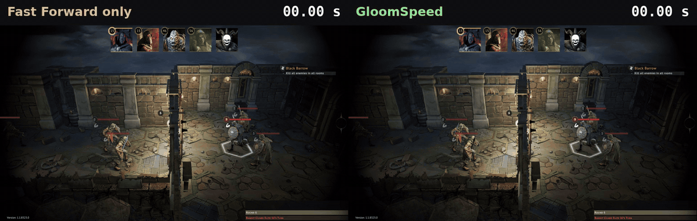
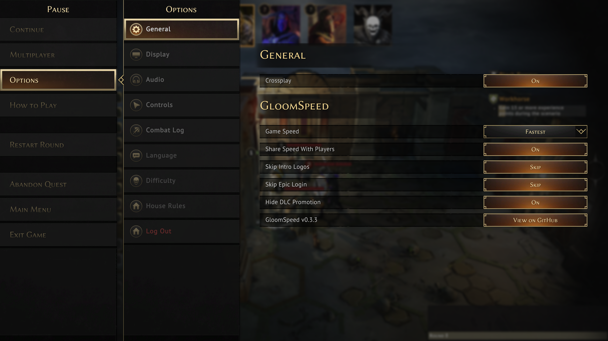
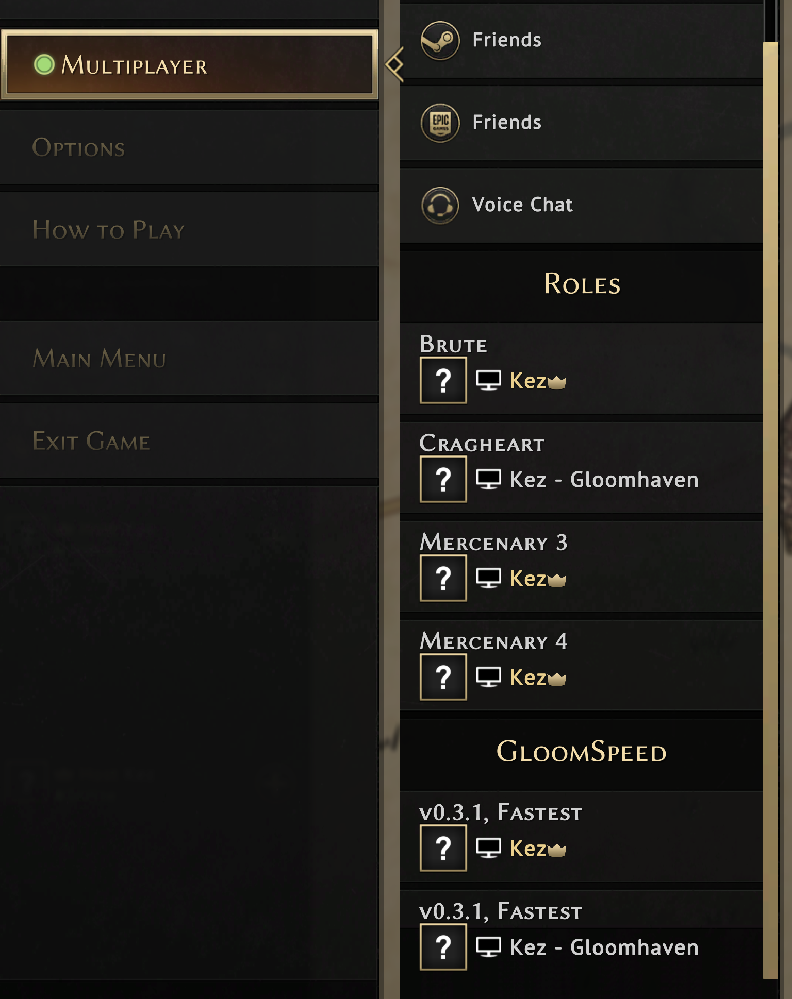
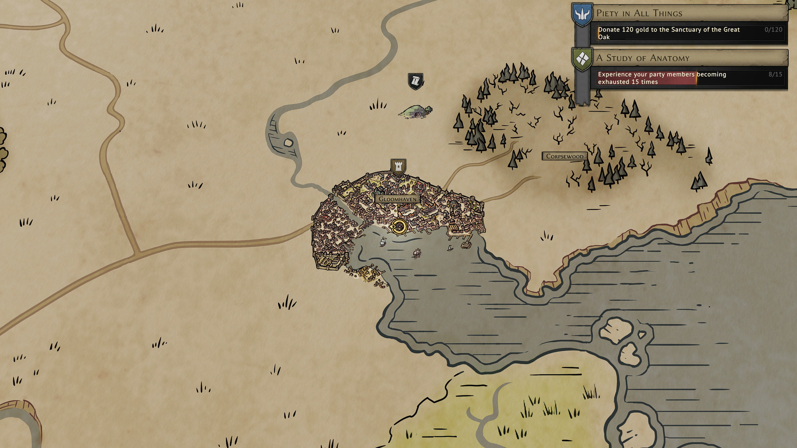
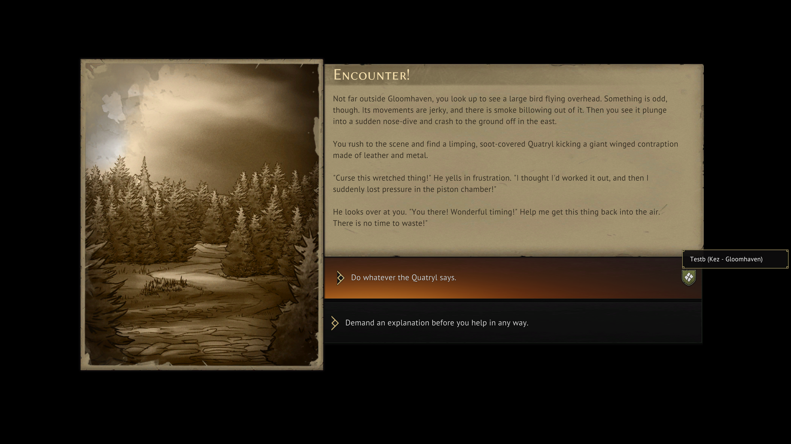
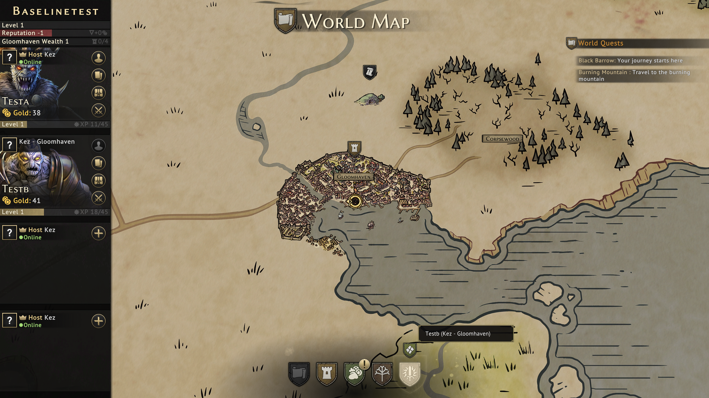
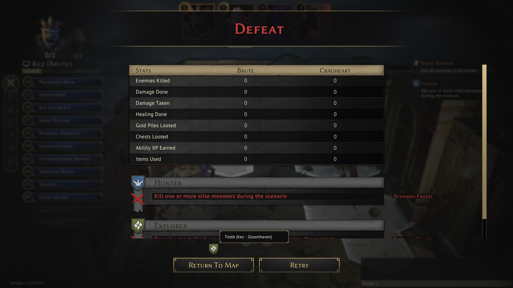
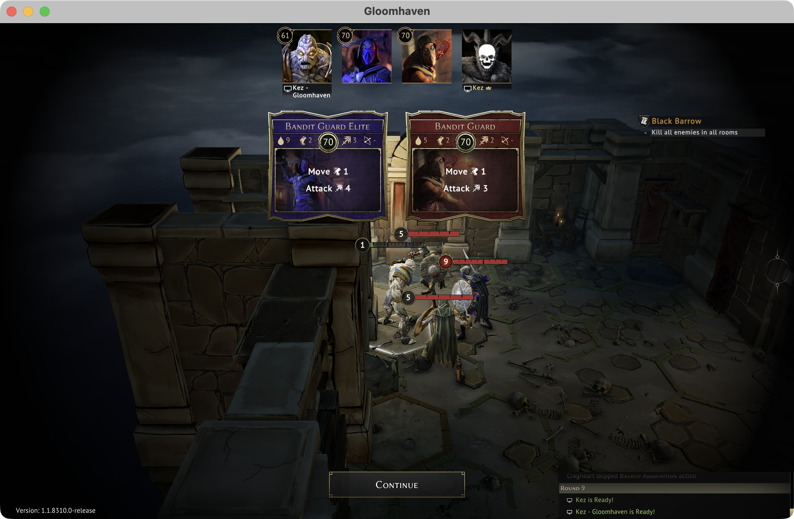

# GloomSpeed

A BepInEx mod that shortens presentation delays in Gloomhaven (Steam, Unity 2021.3.5 Mono), plus the tools used to measure them.

**The same enemy phase, side by side:** five enemies each apply Shield. Fast Forward alone takes 10.8s, and GloomSpeed takes 4.8s (2.27x). The footage isn't retimed; the GloomSpeed side only freezes once it has finished. ([MP4 version](docs/media/speedup-side-by-side.mp4))

**This is close to the best case, not the typical result.** Rounds with self-buffs gain the most, up to 3.5x. Attack-heavy rounds gain 1.2x to 1.7x. Across 13 matched solo enemy phases the mod was 1.88x faster overall. Multiplayer hasn't been measured. Details are in [the test report](mod/test/REPORT.md).

## Install

Download the installer for your computer:

| Your computer | Download |
|---|---|
| **Mac** | [`GloomSpeed-0.3.3-Install-macOS.zip`](https://github.com/dan-kez/gloomspeed/releases/download/v0.3.3/GloomSpeed-0.3.3-Install-macOS.zip) |
| **Windows** | [`GloomSpeed-0.3.3-Install-Windows.zip`](https://github.com/dan-kez/gloomspeed/releases/download/v0.3.3/GloomSpeed-0.3.3-Install-Windows.zip) |
| **Linux (Steam with Proton)** | [`GloomSpeed-0.3.3-Install-Linux.zip`](https://github.com/dan-kez/gloomspeed/releases/download/v0.3.3/GloomSpeed-0.3.3-Install-Linux.zip) |

Unzip it and double-click the installer inside. **[The install guide](INSTALL.md) walks through every step** and assumes you've never installed a mod. Your computer may show a security warning the first time, and the guide covers what to click. On a Mac you also paste one line into Steam, and the installer copies it for you. If you'd rather not run a script, the guide also covers [installing by hand](INSTALL.md#install-by-hand).

It doesn't change your saves or mark them as modded, and you can remove it at any time.

**Everyone in your group should install it.** The host waits for the slowest player, so one player without it can hold up the group.

## What it does

In the game, under **Options > General**:

| Setting | What it does |
|---|---|
| **Game Speed** | **Normal**, **Fast Forward** (the game's own), **Faster** (the same speed, without enemy banners and other fixed delays), or **Fastest** (the default: 5x, 6x on enemy turns, plus shorter reveals). Applies immediately, and replaces the game's Auto Fast Forward row. |
| **Share Speed With Players** | On by default. When you host, other players follow your speed until the session ends. Their own choice is kept. |
| **Skip Intro Logos** | Skips the startup video and logos. Off by default. |
| **Skip Epic Login** | Stops the Epic sign-in window opening at startup. Off by default. Epic friends and invites stay unavailable, but Steam multiplayer doesn't need them. |
| **Hide DLC Promotion** | Hides the DLC advert at the top right of the main menu. Off by default. |

During multiplayer:

- A **GloomSpeed** section in the in-game **Multiplayer** menu lists each player's mod version and Game Speed.
- A notice appears at the top right if someone's version or speed differs, or their status can't be read.
- It fixes a game bug where a player could stay stuck on "Waiting for other players..." when a scenario starts. Every player needs this version for that to help them.
- **Voting:** players who aren't hosting can click options to show which they'd pick, on road and city events, quest selection, drawing a city event, and Retry or Return after a loss. Their character's icon shows beside the option, with their name on hover. The host still decides.
- **Shared Continue:** any player can press **Continue** when the enemy cards are revealed, not just the host.
- At **Faster** and **Fastest**, personal quest progress after a scenario shows all at once, not one at a time. Four toasts take about 5.6 seconds, down from about 22.
- The host's game can write a log of how long each player takes to finish each step, in `BepInEx/GloomSpeed`. It's stored locally, includes player names, and isn't uploaded.

The game's Skip Attack key no longer changes speed.

## Status

**This is an early test version.**

| | Status |
|---|---|
| Linux (Proton) | Played solo, and hosted multiplayer |
| macOS | Played solo, and joined multiplayer as a client. One run on an earlier build ended in a system crash, cause unknown ([details below](#known-issues)) |
| Windows | Not yet run on a real PC, including the installer |
| Multiplayer | Tested between one Linux host and one Mac, with enemy phases at full speed and no desyncs. Sessions with more players, and full scenarios, haven't been tested. How much time it saves in multiplayer hasn't been measured |

It changes pacing only and doesn't touch rule code or skip acknowledgements. It adds its own small status, vote and Continue messages between players, separate from the game's network traffic. Consider trying a throwaway campaign first.

### Known issues

- **macOS crash:** a Mac froze after opening the General tab, then restarted when its display service (WindowServer) stopped responding. It didn't happen again in later testing on newer builds, but the cause is unknown, so the mod can't be ruled out.
- **Stuck on "Waiting for other players...":** the fix is proven when a scenario starts. Returning to the map has the same risk, but the bug hasn't occurred there since the fix went in, so the fix is unproven on that path.
- **Faster and Fastest on attacks:** attack sequences gain little, and can take slightly longer when damage prompts are answered quickly.
- **Scrollbar:** the multiplayer menu gains a scrollbar when the GloomSpeed section appears, which narrows its rows slightly.

Please [open an issue](https://github.com/dan-kez/gloomspeed/issues) if you hit something, with `BepInEx/LogOutput.log` from your game folder.

## What's in this repository

- `mod/GloomSpeed/`: the plugin. Its README covers building, installing and config.
- `mod/install/windows/`, `mod/install/macos/` and `mod/install/linux/`: the installers for players.
- `mod/install/package.py`: builds the release zips.
- `mod/install/gloomspeed.sh`: developer install, uninstall and update for Proton on Linux, using a local build.
- `mod/tools/`: patch target verifier and asset dumper.
- `mod/REPORT.md`: how Fast Forward and multiplayer acknowledgements work.
- `baseline/`: solo enemy-turn measurements and analysis tools.
- `mod/test/REPORT.md`: solo before-and-after results.
- `mod/test/tools/`: scripts that drive the game for in-game tests.

Game code, game assemblies, BepInEx, saves and session logs are deliberately not in this repository. See `.gitignore`. Release zips bundle BepInEx, with its licences included.

## Disclaimer

This is an unofficial fan project, not affiliated with or endorsed by Flaming Fowl Studios, Twin Sails Interactive, Asmodee or Cephalofair Games. You need your own copy of Gloomhaven. Use it at your own risk.
